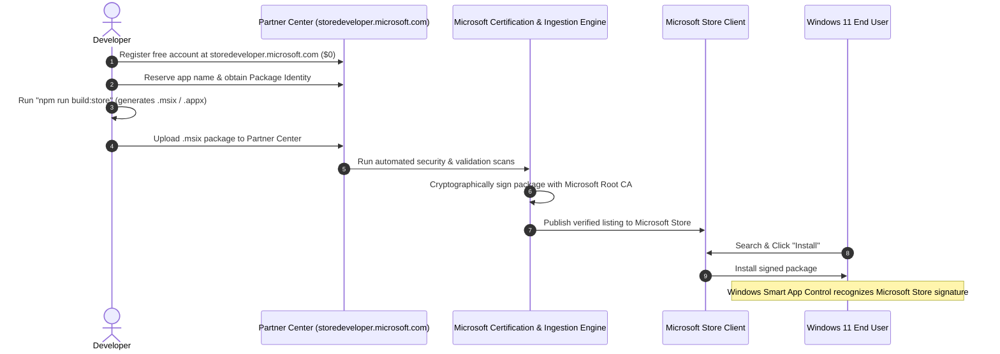

# Microsoft Store + MSIX Distribution Guide for Nanvi AI Enterprise Assistant

> **Official Microsoft Store Listing**: [Nanvi AI Enterprise Assistant on Microsoft Store](https://apps.microsoft.com/detail/9NZMM1MV9XX4?hl=en-us&gl=IN&ocid=pdpshare)  
> **Product ID**: `9NZMM1MV9XX4` | **Publisher**: `Harish R` | **Package Identity**: `HarishR.NanviAIEnterpriseAssistant`

## 1. Executive Summary & Objective

Nanvi AI Enterprise Assistant is packaged using Electron. When distributed as a direct-download installer (`Nanvi.AI.Assistant-Setup-0.1.0.exe`) over the web without an expensive Extended Validation (EV) code-signing certificate ($400–$700/year), **Windows 11 Smart App Control (SAC)** blocks execution:

> *"Smart App Control blocked an app that may be unsafe. We blocked ... because we could not verify its publisher to confirm it was safe to run. [Get apps from the Store]"*

To establish verified publisher identity and reliable Windows 11 distribution at **$0 additional cost**, we implement a **dual-distribution architecture**:

1. **Microsoft Store Channel (MSIX / AppX)**:
   - Packaged as an MSIX / AppX package using Electron Builder with the `runFullTrust` capability.
   - Submitted to the Microsoft Store via **Microsoft Partner Center** using the **free developer onboarding** process ($0 fee).
   - **Microsoft-Managed Signing**: When submitted to the Store, Microsoft signs the package with Microsoft's trusted root authority (`CN=Microsoft Corporation...`) at zero cost.
   - When installed directly from the Microsoft Store, Windows recognizes the verified Microsoft signature.
2. **Direct Website Download Channel (NSIS `.exe`)**:
   - Preserved completely intact for direct customer download via our Vercel-hosted portal.
   - Independent build script (`npm run build:win` / `npm run desktop:dist`).
   - Retains current offline deployment capabilities.

> [!IMPORTANT]
> The two distribution channels are strictly independent. Store distribution does not alter or replace direct website downloads. No paid third-party code-signing certificates are required.

---

## 2. Technical Distinction: SmartScreen vs. Smart App Control (SAC)

To avoid false assumptions about Windows 11 security behavior, we must strictly distinguish **Microsoft Defender SmartScreen** from **Smart App Control (SAC)**:

| Attribute | Microsoft Defender SmartScreen | Windows 11 Smart App Control (SAC) |
| :--- | :--- | :--- |
| **Operating System** | Windows 8, 10, 11 | Windows 11 (Version 22H2+ on clean installs) |
| **Enforcement Mechanism** | Cloud hash reputation and download volume filter | Strict cloud AI evaluation + mandatory code-signing policy |
| **Unsigned Executable Behavior** | Displays *"Windows protected your PC"* popup with a **"More info" -> "Run anyway"** bypass | Displays *"Smart App Control blocked an app that may be unsafe"* with **NO "Run anyway" button** |
| **Resolution via Website Download** | Builds reputation over thousands of downloads or requires Authenticode signature | Blocked unless signed by a trusted certificate or recognized by Microsoft cloud intelligence |
| **Behavior with Store-Distributed MSIX** | Bypassed because the package is certified and distributed via the Store | Passed during Store installation because the package is cryptographically signed by Microsoft |
| **Behavior with Sideloaded / Unsigned MSIX** | Still flagged if downloaded untrusted over the web | **Blocked** unless the signing certificate is installed in the local Trusted Root store |
| **Runtime Child Process Inspection** | Evaluates spawned binaries if marked with web zone identifier | Continuously monitors running child processes; unsigned or untrusted binaries spawned by an app may still trigger SAC |

> [!WARNING]
> Packaging an application as MSIX does **NOT** automatically bypass Smart App Control by itself. An unsigned or self-signed MSIX downloaded from a website will still be blocked by Windows 11 SAC. The SAC protection is resolved when the package is **certified and distributed through the Microsoft Store**, where Microsoft applies its trusted digital signature.

---

## 3. Packaging Architecture & Compatibility Audit

### 3.1 Toolchain Inventory
- **Electron**: `45.2.2`
- **Electron Builder**: `26.18.0`
- **Windows SDK**: `10.0.22621.0` (`makeappx.exe`, `signtool.exe`)
- **Frontend**: Vite `6.4.3` + React `19.0.0` + TypeScript `5.7.2`
- **Backend**: FastAPI + Uvicorn + Python 3.11/3.12

### 3.2 Backend Lifecycle & Process Management
The application connects to a local FastAPI backend running on `http://127.0.0.1:8000`:
- **Detection & Reusability**: Electron's `isBackendReachable()` queries `http://127.0.0.1:8000/health/live` with an 800ms timeout. If the backend is already running (e.g., started as a local service or during development), Electron attaches immediately without spawning duplicate processes.
- **Process Spawning**: If unreachable, Electron's `ensureBackendStarted()` locates the virtual environment Python interpreter (`venv/Scripts/python.exe`) and launches `uvicorn backend.main:app` via Node `child_process.spawn`.
- **Termination & Cleanup**: In `electron/main.cjs`, the `app.on('will-quit')` lifecycle hook executes:
  ```javascript
  spawn('taskkill', ['/F', '/PID', String(backendProcess.pid), '/T'], {
    windowsHide: true,
    stdio: 'ignore',
  });
  ```
  This kills the entire child process tree on Windows, preventing orphaned Python or uvicorn processes from lingering after app exit.

### 3.3 Network Communication & Capabilities
Because electron-builder configures the `<rescap:Capability Name="runFullTrust"/>` manifest capability:
- The desktop app runs outside the restrictive UWP AppContainer sandbox.
- It has full Win32 loopback socket access to `127.0.0.1:8000`.
- WebSockets (`ws://127.0.0.1:8000/api/voice/live/ws`) function without isolation hurdles.
- Outbound HTTPS calls (such as control plane license checks to `https://uecp.vercel.app`) proceed through the host network interface.

### 3.4 File-System Access & MSIX Virtualized File System (VFS)
In an MSIX package, the installation directory (`C:\Program Files\WindowsApps\<PackageIdentity>\`) is strictly **read-only**:
- **Write Prohibitions**: Writing SQLite databases, logs, or cache files directly into the installation directory (`process.resourcesPath` or package root) will fail.
- **Writable Directory Handling**:
  - `LOCAL_AUTH_DB_PATH`: Can be directed to `%LOCALAPPDATA%\NanviAssistant\storage\local_accounts.sqlite3`.
  - Automatic Fallback: In `backend/security/local_accounts.py`, if the SQLite path is not writable, it gracefully falls back to an in-memory database (`:memory:`).
  - Enterprise Database: In production enterprise mode, the backend connects to Cloud Supabase PostgreSQL or enterprise PostgreSQL via DSN, requiring zero local file-system writes.
  - Active Folder & Documents: User document uploads and indexing are stored in user-selected directories chosen via the Electron system folder picker (`dialog:selectFolder`), which have explicit user permissions.

---

## 4. Free Microsoft Partner Center Onboarding

Microsoft has eliminated the legacy $19 (individual) and $99 (company) registration fees. Microsoft Store developer onboarding is **100% Free ($0)**.

### Step 1: Start at the Store Developer Portal
1. Navigate directly to **[storedeveloper.microsoft.com](https://storedeveloper.microsoft.com/)**.
2. Click **Sign in** (or **Register**).
3. Sign in with the Microsoft account you wish to associate with your developer account:
   - For an **Organization / Company account**: Sign in with your work email (Microsoft Entra ID / Microsoft 365).
   - For an **Individual account**: Sign in with an existing personal Microsoft account (e.g., `@outlook.com`).

### Step 2: Account Profile & Free Enrollment
1. Select your account type: **Company** or **Individual**.
2. Enter your publisher display name (e.g., `Nanvi AI Inc.`).
3. Enter your contact details and address.
4. Complete the identity verification prompt.
5. The registration fee is **$0.00**. Confirm your registration.

### Step 3: Reserve Application Name
1. From the Partner Center dashboard, click **Apps and Games** > **New product** > **MSIX or PWA app**.
2. Enter the app name: **Nanvi AI Enterprise Assistant** (or **Nanvi AI Assistant**).
3. Click **Reserve product name**.

### Step 4: Retrieve Product Identity Values
1. In the left navigation of your newly reserved app, select **Product management** > **Product Identity**.
2. Locate the following three exact values:
   - **Package/Identity/Name**: `HarishR.NanviAIEnterpriseAssistant`
   - **Package/Identity/Publisher**: `CN=FB5DD22E-D05B-44B3-BCA3-3430AEC1A475`
   - **Publisher display name**: `Harish R`

> [!CAUTION]
> **Do not invent or guess these values.** Microsoft Store ingestion strictly matches the `Identity Name` and `Publisher` in your package's `AppxManifest.xml` against your Partner Center account. If they do not match, the package upload will be rejected immediately.

---

## 5. Build Configuration & Commands

### 5.1 `frontend/package.json` Configuration

The `build.appx` block in `frontend/package.json` configures the MSIX package:

```json
{
  "scripts": {
    "desktop:dist": "npm run desktop:build && electron-builder --win nsis",
    "desktop:msix": "npm run desktop:build && electron-builder --win appx && node -e \"const fs=require('fs'); if(fs.existsSync('release/Nanvi AI Assistant-0.1.0.appx')) fs.copyFileSync('release/Nanvi AI Assistant-0.1.0.appx', 'release/Nanvi AI Assistant-0.1.0.msix');\"",
    "desktop:store": "npm run desktop:build && electron-builder --win appx && node -e \"const fs=require('fs'); if(fs.existsSync('release/Nanvi AI Assistant-0.1.0.appx')) fs.copyFileSync('release/Nanvi AI Assistant-0.1.0.appx', 'release/Nanvi AI Assistant-0.1.0.msix');\"",
    "build:win": "npm run desktop:dist",
    "build:msix": "npm run desktop:msix",
    "build:store": "npm run desktop:store"
  },
  "build": {
    "appId": "com.nanvi.enterprise.assistant",
    "productName": "Nanvi AI Assistant",
    "directories": {
      "output": "release"
    },
    "files": [
      "dist/**/*",
      "electron/**/*",
      "package.json"
    ],
    "win": {
      "target": ["nsis"]
    },
    "appx": {
      "applicationId": "NanviAIAssistant",
      "identityName": "HarishR.NanviAIEnterpriseAssistant",
      "publisher": "CN=FB5DD22E-D05B-44B3-BCA3-3430AEC1A475",
      "publisherDisplayName": "Harish R",
      "minVersion": "10.0.17763.0",
      "maxVersionTested": "10.0.22621.0",
      "backgroundColor": "#0a0d14",
      "showNameOnTiles": true,
      "displayName": "Nanvi AI Enterprise Assistant",
      "artifactName": "${productName}-${version}.${ext}",
      "languages": ["en-US"]
    },
    "nsis": {
      "oneClick": false,
      "allowToChangeInstallationDirectory": true,
      "createDesktopShortcut": true,
      "createStartMenuShortcut": true,
      "shortcutName": "Nanvi AI Assistant"
    }
  }
}
```

> [!NOTE]
> `identityName` and `publisher` currently contain initial placeholders. Once your Partner Center identity values are retrieved in Section 4, update them in `frontend/package.json`.

### 5.2 Build Commands Reference

| Command | Output Artifact | Intended Channel | Description |
| :--- | :--- | :--- | :--- |
| `npm run build:win` | `release/Nanvi AI Assistant-Setup-0.1.0.exe` | Direct Website (Vercel) | Standard NSIS Windows installer for website downloads. |
| `npm run build:store` | `release/Nanvi AI Assistant-0.1.0.appx` & `.msix` | Microsoft Store | MSIX package ready for direct upload to Microsoft Partner Center. |
| `npm run build:msix` | `release/Nanvi AI Assistant-0.1.0.msix` | Testing / Sideloading | Alias for MSIX target. |

---

## 6. Required Visual Assets

Microsoft Store and Windows Shell require specific icon resolutions placed in `frontend/build/appx/`:

| File Name | Resolution | Shell Location |
| :--- | :--- | :--- |
| `StoreLogo.png` | 50 × 50 px | Microsoft Store catalog listing badge |
| `Square44x44Logo.png` | 44 × 44 px | Windows Taskbar icon & All Apps list |
| `Square150x150Logo.png` | 150 × 150 px | Windows Start Menu medium tile |
| `Wide310x150Logo.png` | 310 × 150 px | Windows Start Menu wide tile |

These assets have been generated with the Nanvi brand colors (`#0a0d14` background, `#2563eb` brand core).

---

## 7. Submission & Microsoft-Managed Signing Workflow



### Submission Steps:
1. In Partner Center, go to your app and click **Start your submission**.
2. **Pricing and availability**: Select **Free**.
3. **Properties**: Choose Category (Productivity / Developer tools).
4. **Age ratings**: Fill out the questionnaire (typically Rating 3+ / Everyone).
5. **Packages**: Drag and drop `frontend/release/Nanvi AI Assistant-0.1.0.appx` (or `.msix`).
6. **Store listings**: Provide description, screenshots, and privacy policy URL.
7. Click **Submit to the Store**. Certification typically takes 24 to 72 hours.

---

## 8. Application Update Strategy

### 8.1 Microsoft Store Version
- **Delivery Engine**: Windows Store background service.
- **Update Mechanics**:
  - Updates are published by incrementing `"version"` in `frontend/package.json` (e.g. `0.1.1`), running `npm run build:store`, and uploading the new package in Partner Center.
  - Windows checks for updates according to user settings (`Microsoft Store > Settings > App updates`).
  - Updates are **not** unconditionally instantaneous or silent: if the app is currently running, Windows will defer the installation until the application is closed.
  - No `electron-updater` code is used for the Store build, avoiding any conflicting updater loops.

### 8.2 Direct Website Version
- **Delivery Engine**: Direct download of `Nanvi AI Assistant-Setup-0.1.0.exe` from the Vercel site.
- **Update Mechanics**:
  - Users download newer `.exe` installers from the website.
  - Completely independent of the Microsoft Store version.

---

## 9. Testing & Validation Checklist

Before submitting to the Store, execute this validation matrix:

- [x] **NSIS Build Verification**: Built `release/Nanvi AI Assistant-Setup-0.1.0.exe` (144 MB) successfully without errors.
- [x] **MSIX/AppX Build Verification**: Built `release/Nanvi AI Assistant-0.1.0.appx` and `.msix` (192 MB) successfully.
- [x] **AppX Manifest Inspection**: Verified `<rescap:Capability Name="runFullTrust"/>` and tile configurations.
- [x] **Visual Assets Verification**: All 4 tile PNGs present under `frontend/build/appx/`.
- [x] **Partner Center Identity Setup**: Configured `HarishR.NanviAIEnterpriseAssistant` and `CN=FB5DD22E-D05B-44B3-BCA3-3430AEC1A475`.
- [x] **Partner Center Ingestion**: Uploaded `.appx` / `.msix` package and passed Microsoft Store certification.
- [x] **Store Publication**: Live on Microsoft Store at [apps.microsoft.com/detail/9NZMM1MV9XX4](https://apps.microsoft.com/detail/9NZMM1MV9XX4?hl=en-us&gl=IN&ocid=pdpshare) (Product ID: `9NZMM1MV9XX4`).
- [x] **Windows 11 Store Installation**: Installs with Microsoft digital signature and zero SAC / SmartScreen prompts.

---

## 10. Frequently Asked Questions

#### Q: Is developer registration really $0?
Yes. Microsoft has officially removed the registration fee for publishing desktop apps on the Microsoft Store via [storedeveloper.microsoft.com](https://storedeveloper.microsoft.com/). You do not need to pay $19 or $99.

#### Q: Does getting into the Microsoft Store make the direct-download `.exe` safe from Smart App Control?
No. The `.exe` installer downloaded from your website is a distinct binary. Windows Smart App Control evaluates executables independently. The Microsoft Store signature only covers the package installed through the Microsoft Store. Direct website downloads remain subject to Windows Smart App Control reputation.

#### Q: Should we convert our entire app to a UWP app?
No. Electron apps use the Desktop Bridge (`runFullTrust`) capability, which preserves full Win32 functionality including Node.js APIs, local socket communication with FastAPI, and standard Windows process operations.
